<div align="center">

# 🛡️ CiteGuard MCP (`citeguard-mcp`)

**Stop LLMs from Hallucinating Fake Papers, Chimera DOIs, and Retracted Citations.**  
*Zero-config Model Context Protocol (MCP) Server & CLI for Claude Code, Cursor, Windsurf, VS Code Copilot, and CI/CD pipelines.*

[](https://github.com/Lukecele/citeguard-mcp/actions/workflows/ci.yml)
[](https://glama.ai/mcp/servers/Lukecele/citeguard-mcp)
[](https://www.python.org/)
[](https://modelcontextprotocol.io/)
[](./pyproject.toml)
[](./LICENSE)



</div>

---

> [!TIP]
> ⭐ **If CiteGuard saves you from an embarrassing hallucinated citation in a paper, grant, PR, or technical report, please consider starring this repository!**

## 🚨 Why CiteGuard?

Even frontier LLMs frequently fail at scientific and technical citations in **three insidious ways**:

1. ❌ **Fabricated Identifiers (`FABRICATED_OR_UNRESOLVED`)**: Inventing plausible-looking DOIs (`10.1038/s41591-025-99999-z`), PubMed PMIDs, or arXiv IDs that return `404`.
2. ⚠️ **Chimera Citations (`CHIMERA_MISMATCH`)**: Grabbing a **real DOI** from a famous paper (so naive regex/HTTP checks pass!) but attaching a **completely fabricated title, wrong author, or wrong year**.
3. 🚨 **Silent Retractions (`RETRACTED`)**: Citing papers that have been formally **retracted** in Crossref, PubMed, or OpenAlex.

**`citeguard-mcp`** solves all three with **zero API keys** and **zero third-party Python dependencies** (100% Python standard library), querying **Crossref, DataCite (CERN Zenodo), PubMed (NCBI E-utilities), OpenAlex, and arXiv** in real time.

---

## ⚡ 10-Second Quickstart

### 1. Plug into Claude Code / Claude Desktop / Cursor / Windsurf (MCP Server)

#### Claude Code (CLI)
```bash
claude mcp add citeguard -- uvx --from git+https://github.com/Lukecele/citeguard-mcp citeguard-mcp serve
```

#### Cursor / Claude Desktop / Windsurf (`mcp.json` or `claude_desktop_config.json`)
```json
{
  "mcpServers": {
    "citeguard": {
      "command": "uvx",
      "args": [
        "--from",
        "git+https://github.com/Lukecele/citeguard-mcp",
        "citeguard-mcp",
        "serve"
      ]
    }
  }
}
```

#### Docker / GHCR (`ghcr.io/lukecele/citeguard-mcp` · Official MCP Registry `io.github.Lukecele/citeguard-mcp`)
```json
{
  "mcpServers": {
    "citeguard": {
      "command": "docker",
      "args": ["run", "-i", "--rm", "ghcr.io/lukecele/citeguard-mcp:0.1.1"]
    }
  }
}
```

### 2. Run Directly from the Terminal (CLI)

```bash
# Install via pipx / uv / pip
pip install git+https://github.com/Lukecele/citeguard-mcp

# 1. Audit an entire Markdown manuscript, LaTeX file, or BibTeX bibliography
citeguard audit manuscript.md --strict
citeguard audit references.bib

# 2. Verify a single DOI + detect Chimera title/author/year hallucinations
citeguard verify "10.1038/s41586-021-03819-2" \
  --title "Highly accurate protein structure prediction with AlphaFold" \
  --author "Jumper" --year 2021

# 3. Search 100% verified literature across OpenAlex, PubMed, Crossref & arXiv
citeguard search "spatial transcriptomics drug resistance" --limit 5

# 4. Generate clean, deterministic BibTeX from a mix of DOIs, PMIDs, and arXiv IDs
citeguard bibtex 10.1038/s41586-021-03819-2 PMID:34265844 arXiv:1706.03762

# 5. Check if a DOI has been retracted
citeguard retraction "10.1016/S0140-6736(97)11096-0"
```

---

## 🧰 MCP Tools Exposed to Your AI Agent

| Tool Name | Description | Registries Queried |
| :--- | :--- | :--- |
| **`verify_citation`** | Verifies a DOI, `PMID:xxxx`, `arXiv:xxxx.xxxxx`, or paper title. Checks claimed title, author, and year to catch **Chimera hallucinations** and **retractions**. Returns canonical BibTeX & APA. | Crossref · DataCite/Zenodo · PubMed · OpenAlex · arXiv |
| **`audit_document_citations`** | Scans an entire Markdown, LaTeX, BibTeX, or draft LLM response concurrently and returns a **Citation Integrity Score (0–100%)** with per-citation diagnostics. | All 5 registries (concurrent thread pool) |
| **`search_verified_literature`** | Searches for real, peer-reviewed / preprint papers **before** the LLM writes a citation, returning verified DOIs, citation counts, open-access PDFs, and BibTeX. | OpenAlex · PubMed (NCBI) · arXiv |
| **`generate_bibtex`** | Resolves an array of DOIs, PMIDs, and arXiv IDs into normalized `@article{...}` BibTeX blocks. | Crossref · DataCite · PubMed · arXiv |
| **`check_retraction`** | Checks Crossref `update-to` notices and OpenAlex `is_retracted` metadata for retractions or expressions of concern. | Crossref · OpenAlex |

---

## 🤖 CI/CD Guardrail for GitHub Pull Requests

Prevent hallucinated or broken DOIs/BibTeX entries from ever being merged into your documentation or papers:

```yaml
- name: Audit citations with CiteGuard
  run: |
    pip install git+https://github.com/Lukecele/citeguard-mcp
    citeguard audit paper.md --strict
```

---

## 🧪 Running Tests

```bash
git clone https://github.com/Lukecele/citeguard-mcp.git
cd citeguard-mcp
pip install -e ".[dev]"
pytest -v
```

---

## 👤 Author & License

Created by **[Luca Celebrano](https://lucacelebrano.me)** ([@Lukecele](https://github.com/Lukecele) · ORCID [`0009-0007-0931-3555`](https://orcid.org/0009-0007-0931-3555)).  
Released under the [MIT License](./LICENSE).
